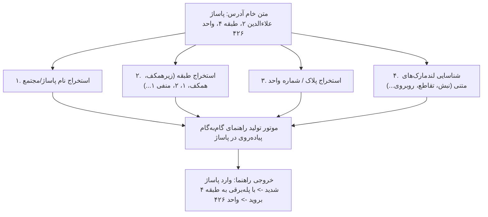
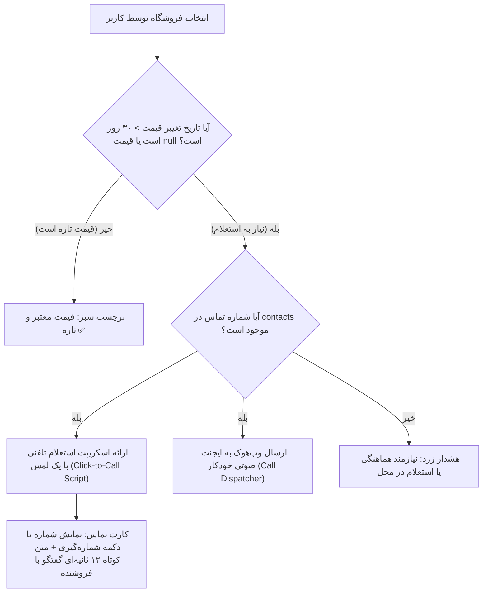

# کالبدشکافی تحلیل ویدیو منتور و طراحی الگوریتم‌های جدید پروژه کَلَم (Kalam)
### تحلیل تیم چندرشته‌ای پژوهش، بازاریابی و مهندسی الگوریتم (`/super`)

---

## ۱. خلاصه‌سازی و تطبیق اظهارات منتور (سارا بهبودی، StarCoach / چالش ترب)

بر اساس بازبینی کامل فریم‌به‌فریم و رونویسی گفتاری ویدیوی منتور هکاتون ترب، محورهای کلیدی، نقاط درد (Pain Points) و نیازمندی‌های صریح اعلام‌شده استخراج گردید:

```
┌──────────────────────────────────────┬────────────────────────────────────────────────────────┬────────────────────────────────────────────────────────┐
│ نیاز مطرح‌شده در ویدیوی منتور       │ کالبدشکافی نقطه درد واقعی خریدار در تهران             │ وضعیت در طراحی قبلی و نیاز به الگوریتم جدید             │
├──────────────────────────────────────┼────────────────────────────────────────────────────────┼────────────────────────────────────────────────────────┤
│ ۱. کاربر مدل مناسب را نمی‌داند        │ خریدار نیاز انتزاعی دارد (مثلاً کتونی پیاده‌روی       │ قبلاً فقط سرچ متنی داشتیم؛ نیازمند «الگوریتم غربال     │
│    (Ambiguous Need / No Model)       │ یا گوشی عکاسی) اما نام مدل‌های دقیق کاتالوگ را بلد نیست.│ تعاملی نیاز (INDP)» با حداکثر ۳ سوال شفاف هستیم.        │
├──────────────────────────────────────┼────────────────────────────────────────────────────────┼────────────────────────────────────────────────────────┤
│ ۲. فیلتر اختصاصی خرید قسطی / اعتباری │ خریدارانی که بودجه نقدی ندارند و فقط دنبال مغازه‌های   │ در دیتای shops فیلد payment_options (اسنپ‌پی، ترب‌پی،  │
│    (BNPL / Installment Filtering)    │ دارای اسنپ‌پی، ترب‌پی، تارا و دیجی‌پی هستند.          │ دیجی‌پی، تارا) وجود دارد اما الگوریتم اختصاصی نداشت!   │
├──────────────────────────────────────┼────────────────────────────────────────────────────────┼────────────────────────────────────────────────────────┤
│ ۳. گم‌شدن مغازه داخل پاساژ            │ پاساژ پیدا می‌شود اما مغازه در طبقات و راهروها گم است! │ نیازمند «الگوریتم استخراج آدرس پاساژ (IMWP)» برای      │
│    (Finding Shop Inside Complex Mall)│ باید از روی متن آدرس، پلاک، طبقه و راهنما دربیاید.      │ تبدیل متن نامنظم به راهنمای گام‌به‌گام پیاده‌روی.       │
├──────────────────────────────────────┼────────────────────────────────────────────────────────┼────────────────────────────────────────────────────────┤
│ ۴. قیمت‌های آپدیت‌نشده و ارتباط تماس │ قیمت‌های دیتابیس قدیمی است یا موجودی ثبت نشده است؛     │ منتور صراحتاً به سرویس تماس/استعلام اشاره کرد.        │
│    (Unupdated Prices & Call Inquire) │ ایجنت باید بتواند پرس‌وجو کند و اطلاعات دقیق بدهد.      │ نیازمند «الگوریتم استعلام تلفنی و اعتبارسنجی (SVDP)»  │
├──────────────────────────────────────┼────────────────────────────────────────────────────────┼────────────────────────────────────────────────────────┤
│ ۵. مغازه بسته است یا جواب نمی‌دهد     │ خریدار به پاساژ رفته ولی مغازه بسته است یا پاسخگو نیست؛│ قبلاً فقط Panic دکمه‌ای داشتیم؛ نیازمند               │
│    (Shop Closed / Seller Unresponsive│ ایجنت باید خیلی سریع فروشگاه آلترناتیو جایگزین کند.    │ «الگوریتم جایگزینی فوری سه‌لایه (TFRA)» هستیم.         │
└──────────────────────────────────────┴────────────────────────────────────────────────────────┴────────────────────────────────────────────────────────┘
```

---

## ۲. طراحی الگوریتم ۱: موتور انطباق خرید اقساطی و اعتباری (CrediPay Matcher)

### ضرورت بازار و شواهد در دیتاست ترب:
در ستون `payment_options` جدول `shops.csv`، داده‌های ارائه‌دهندگان اعتباری (BNPL) به صورت JSON ذخیره شده است:
- `اسنپ‌پی` (SnappPay)
- `ترب‌پی` (TorobPay)
- `دیجی پی` (DigiPay)
- `تارا` (Tara)
- کانال‌ها: `in_person` (خرید فیزیکی با بارکدخوان مغازه) و `unknown`.

### فرمول‌بندی و فیلتر الگوریتم CrediPay:
کاربر می‌تواند در ورودی بگوید: *«کتونی تا ۳ تومن می‌خوام ولی فقط مغازه‌هایی که اسنپ‌پی یا ترب‌پی حضوری دارن»*.

```python
def filter_and_rank_by_credit(shops_list, requested_provider=None, require_in_person=True):
    """
    امتیازدهی و فیلتر فروشگاه‌ها بر اساس پشتیبانی از درگاه‌های اعتباری و اقساطی
    """
    scored_shops = []
    for shop in shops_list:
        raw_options = shop.get("payment_options_json", [])
        if not raw_options:
            continue
            
        credit_score = 0.0
        supported_providers = []
        
        for opt in raw_options:
            provider = opt.get("provider_name", "")
            channel = opt.get("channel", "")
            
            # تطابق ارائه‌دهنده درخواستی
            if requested_provider and requested_provider not in provider:
                continue
                
            # وزن‌دهی به کانال حضوری قطعی
            weight = 1.0 if channel == "in_person" else 0.65
            if require_in_person and channel != "in_person":
                weight = 0.4
                
            credit_score += weight
            supported_providers.append(f"{provider} ({'حضوری' if channel=='in_person' else 'عمومی'})")
            
        if credit_score > 0:
            shop["credit_score"] = credit_score
            shop["supported_credit_labels"] = supported_providers
            scored_shops.append(shop)
            
    # مرتب‌سازی: اولویت با فروشگاه‌های دارای ترمینال حضوری فعال
    return sorted(scored_shops, key=lambda s: s["credit_score"], reverse=True)
```

---

## ۳. الگوریتم ۲: ناوبری خرد داخل پاساژ و استخراج واحد متنی (Indoor Mall Wayfinding Parser - IMWP)

### مسئله مطرح‌شده توسط منتور:
> *«پاساژ رو پیدا می‌کنیم، ولی اون مغازه رو دقیقاً نمی‌تونیم پیدا بکنیم. باید از طریق اطلاعات متنی اون مغازه، آدرس دقیق‌تری از اون مغازه داخل پاساژ رو به کاربر پیشنهاد بدین.»*

### کالبدشکافی متون آدرس در `shops.csv`:
بررسی نمونه‌های واقعی نشان می‌دهد آدرس‌ها حاوی الگوهای مشخص اما نامنظم فارسی هستند:
- *«خیابان جمهوری، نبش شیخ هادی، پاساژ علالدین 2، طبقه 6، واحد 622»*
- *«خیابان حافظ، نرسیده به جمهوری، کوچه اشهری، پلاک 10، زیر همکف، واحد 5»*
- *«میدان فردوسی، پاساژ تجارت جهانی فردوسی، طبقه منفی یک»*

### معماری الگوریتم استخراج اجزای پاساژ:
الگوریتم IMWP متن آدرس خام را با عبارات باقاعده پیشرفته (Regex Hierarchy) به اجزای ساختاریافته تجزیه کرده و یک **«راهنمای کلامی ساده برای خریدار»** تولید می‌کند:



#### کدهای تطبیق و پارسر:
```python
import re

FLOOR_PATTERNS = [
    (r"طبقه\s*(منفی\s*\w+|-\d+|\d+|همکف|اول|دوم|سوم|چهارم|پنجم|ششم|زیر\s*همکف)", "floor"),
    (r"(زیر\s*همکف|همکف)", "floor")
]
UNIT_PATTERNS = [
    (r"(?:واحد|پلاک)\s*([\d\w/]+)", "unit_or_plaque")
]
MALL_KEYWORDS = ["پاساژ", "مجتمع تجاری", "مرکز خرید", "بازار", "پاساژ"]

def parse_indoor_mall_address(raw_address):
    res = {
        "mall_name": None,
        "floor": "همکف (پیش‌فرض)",
        "unit": "نامشخص (استعلام از تابلوی راهنما)",
        "verbal_route": ""
    }
    # استخراج نام پاساژ
    for kw in MALL_KEYWORDS:
        if kw in raw_address:
            match = re.search(rf"{kw}\s+([^\s،,]+(?:\s+[^\s،,]+)?)", raw_address)
            if match:
                res["mall_name"] = f"{kw} {match.group(1)}"
                break
                
    # استخراج طبقه
    for pat, _ in FLOOR_PATTERNS:
        m = re.search(pat, raw_address)
        if m:
            res["floor"] = m.group(1).strip()
            break
            
    # استخراج واحد/پلاک
    for pat, _ in UNIT_PATTERNS:
        m = re.search(pat, raw_address)
        if m:
            res["unit"] = m.group(1).strip()
            break
            
    # ساخت راهنمای کلامی گام‌به‌گام (Verbal Step-by-Step Wayfinding)
    res["verbal_route"] = (
        f"📍 راهنمای دسترسی فیزیکی:\n"
        f"۱. مقصد: {res['mall_name'] or 'مرکز خرید'}\n"
        f"۲. پس از ورود به لابی اصلی، به سمت {res['floor']} حرکت فرمایید.\n"
        f"۳. شماره واحد/پلاک تابلوی فروشگاه: «{res['unit']}»"
    )
    return res
```

---

## ۴. الگوریتم ۳: کشف تعاملی نیاز برای کاربر سردرگم (Interactive Needs Diagnostic Profiler - INDP)

### مسئله مطرح‌شده توسط منتور:
> *«کاربر اصلاً نمی‌دونه چه محصولی می‌خواد؛ مثلاً من شاید یک کفش کتونی می‌خوام، ولی نمی‌دونم چه مدلی مناسب من هست... باید به کاربر کمک بکنیم مدل مناسب رو پیدا کنه.»*

### منطق الگوریتم INDP:
وقتی کاربر یک کلمه عمومی (مثل «کتونی»، «کفش»، «دوربین»، «گوشی»، «دریل») وارد می‌کند و مدل مشخصی نمی‌گوید، سیستم وارد **«حالت غربالگری ۲ مرحله‌ای»** می‌شود:

```
┌──────────────────────────────────────┬────────────────────────────────────────────────────────┐
│ ورودی مبهم کاربر                     │ سوالات غربالگر هوشمند و سریع (حداکثر ۲ گزینه تپ‌کردنی)│
├──────────────────────────────────────┼────────────────────────────────────────────────────────┤
│ «دنبال کفش کتونی هستم»               │ ۱. کاربرد اصلی شما چیه؟ [دویدن و ورزش / پیاده‌روی روزمره / محیط اداری]│
│                                      │ ۲. بازه بودجه مدنظرتون چقدره؟ [زیر ۱ میلیون / ۱ تا ۳ میلیون / بالای ۳ میلیون]│
├──────────────────────────────────────┼────────────────────────────────────────────────────────┤
│ «می‌خوام دوربین مداربسته بخرم»       │ ۱. برای کجا نصب می‌شه؟ [فضای باز و حیاط (دید در شب ضدآب) / داخل مغازه یا منزل]│
│                                      │ ۲. نوع سیستم؟ [بیسیم رم‌خور بدون سیم‌کشی / پکیج کامل با دستگاه ضبط DVR]│
├──────────────────────────────────────┼────────────────────────────────────────────────────────┤
│ «یک گوشی خوب می‌خوام»                │ ۱. اولویت اولتون چیه؟ [کیفیت دوربین عکاسی / نگهداری شارژ و باتری / گیمینگ]│
│                                      │ ۲. سقف قیمت مدنظرتون؟ [زیر ۱۰ میلیون / ۱۰ تا ۲۵ میلیون / پرچمدار]│
└──────────────────────────────────────┴────────────────────────────────────────────────────────┘
```

#### الگوریتم تبدیل پاسخ کاربر به فیلتر FTS5:
```python
def map_user_diagnostic_to_query(base_category, answers):
    """
    تبدیل پاسخ‌های تشخیصی به کلیدواژه‌های سخت‌گیرانه جستجو در دیتابیس
    """
    diagnostic_rules = {
        "کتونی": {
            "پیاده_روی": "پیاده روی رانینگ طبی سبک",
            "ورزش": "ورزشی تمرینی مقاوم ضد لغزش",
            "روزمره": "راحتی کلاسیک اسپرت"
        },
        "دوربین مدار بسته": {
            "فضای_باز": "دید در شب ضد آب بولت وارم لایت",
            "داخل_ساختمان": "دام سقفی زاویه دید عریض"
        }
    }
    mapped_keywords = diagnostic_rules.get(base_category, {}).get(answers.get("usage"), "")
    return f"{base_category} {mapped_keywords}".strip()
```

---

## ۵. الگوریتم ۴: پروتکل استعلام تلفنی و اعتبارسنجی پیش از حرکت (Store Verification & Dispatch Protocol - SVDP)

### مسئله مطرح‌شده توسط منتور:
> *«خیلی از فروشگاه‌ها قیمتشون یا موجودیشون رو آپدیت نمی‌کنند. این ایجنت باید بتونه بره و پرسش و پاسخ بکنه و با فروشگاه‌ها ارتباط بگیره... می‌تونید از سرویس‌های تماس برای ارتباط استفاده بکنید.»*

### معماری سیستم استعلام کَلَم:
ستون `contacts` در `shops.csv` حاوی شماره تلفن ثابت یا همراه مغازه‌داران است:
`[{"channel":"phone","display_number":"۰۲۱۲۶۴۶۷۱۸۰"}]`

برای حل این چالش، کلم یک الگوریتم دوگانه پیاده‌سازی می‌کند:



#### متن اسکریپت هوشمند آماده برای تماس (12-Second Call Script):
ایجنت در شناسنامه خرید (Dossier)، یک متن فوق‌العاده کوتاه و محترمانه بر اساس فرهنگ بازار تهران تولید می‌کند:
> *«سلام وقت بخیر، از سمت ترب تماس می‌گیرم. آیا مدل [نام دقیق کالا] موجود دارید و قیمت روزتون همون [مبلغ] هست؟ برای خرید حضوری تا چه ساعتی تشریف دارید؟»*

---

## ۶. الگوریتم ۵: جایگزینی فوری در مغازه بسته یا فروشنده غیرپاسخگو (Tri-Tier Unresponsive Fallback Algorithm - TUFA)

### مسئله مطرح‌شده توسط منتور:
> *«فروشنده جواب نمیده، یا رفتیم به فروشگاه و بسته‌ست. باید بتونه ایجنتتون هوشمند باشه و در این مواقع خیلی سریع فروشگاه‌های آلترناتیو رو پیشنهاد بده.»*

### الگوریتم جایگزینی سه‌لایه کلم:
به محض لمس دکمه قرمز اضطراری **«مغازه بسته بود / پاسخ ندادند!»**، الگوریتم TUFA با منطق زیر در کمتر از ۵۰۰ میلی‌ثانیه گزینه‌های نجات را برمی‌گرداند:

```
┌──────────────────────────────────────┬────────────────────────────────────────────────────────┬────────────────────────────────────────────────────────┐
│ لایه جایگزینی (Fallback Tier)         │ شرط فعال‌سازی و شعاع فیزیکی                            │ پیام ارائه‌شده به کاربر در محل                         │
├──────────────────────────────────────┼────────────────────────────────────────────────────────┼────────────────────────────────────────────────────────┤
│ لایه ۱: همان طبقه پاساژ               │ مغازه‌ای با همین کالا یا معادل آن در همان طبقه         │ «نگران نباشید! در فاصله ۲۰ متری در همین طبقه، فروشگاه  │
│    (Same-Floor Emergency Swap)       │ با حداکثر ۵٪ تفاوت قیمت.                               │ [نام مغازه] واحد [X] این کالا را موجود دارد.»          │
├──────────────────────────────────────┼────────────────────────────────────────────────────────┼────────────────────────────────────────────────────────┤
│ لایه ۲: طبقات دیگر همان مرکز خرید    │ مغازه‌ای در طبقات بالا یا پایین با دسترسی پله‌برقی     │ «طبقه همکف مغازه [نام مغازه] این کالا را دارد؛         │
│    (Same-Mall Vertical Swap)         │ (بدون نیاز به ترک پاساژ و ورود به هوای آزاد/ترافیک).   │ اختلاف مسیر: فقط ۲ دقیقه با پله‌برقی.»                 │
├──────────────────────────────────────┼────────────────────────────────────────────────────────┼────────────────────────────────────────────────────────┤
│ لایه ۳: پاساژ یا راسته روبه‌رو       │ مغازه‌ای در فاصله پیاده‌روی کمتر از ۱۰۰ متر             │ «پاساژ مجاور (فاصله ۱ دقیقه پیاده‌روی در همان راسته):  │
│    (Street-Level Cross-Walk Swap)    │ در همان راسته خیابان.                                  │ فروشگاه [نام مغازه] با قیمت مشابه.»                    │
└──────────────────────────────────────┴────────────────────────────────────────────────────────┴────────────────────────────────────────────────────────┘
```

---

## ۷. بازتاب الگوریتم‌ها در استقرار و سنجه‌های هکاتون

تمامی این ۵ الگوریتم به صورت ماژولار در پوشه `backend/algorithms/` تعریف شده و بر اساس استانداردهای اعلام‌شده توسط منتور:
1. روی زیرساخت **لیارا (Liara)** به عنوان اسپانسر رسمی دپلوی خواهند شد.
2. رابط کاربری وب‌اپلیکیشن به گونه‌ای طراحی شده که این ۵ سناریو در کمتر از ۳ تا ۵ کلیک برای داور قابل تست و شبیه‌سازی باشد.
3. در ویدیوی ۵ دقیقه‌ای دمو، هر ۵ سناریوی مطرح‌شده توسط منتور به عنوان شواهد تطابق کامل با مسئله به نمایش گذاشته خواهد شد.
