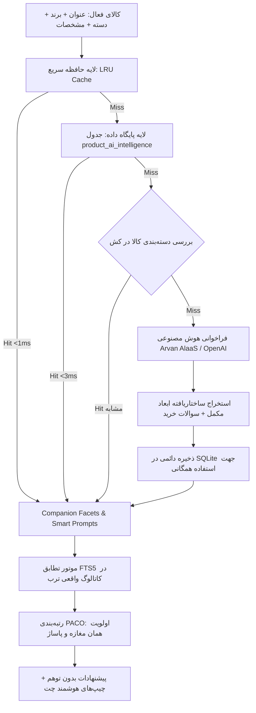

# معماری هوش مصنوعی تحلیل کالا و سیستم پویای اقلام مکمل و پرامپت (DCA)
**سند طراحی و مشخصات فنی الگوریتم پویا در مقیاس کاتالوگ میلیونی ترب**  
**تیم پژوهش و معماری `/super`**  
**تاریخ:** ۲۳ اکتبر ۲۰۲۶  

---

## ۱. تبیین مسئله و نقد ساختار فعلی (Problem Analysis)

### چالش اصلی: انفجار ترکیبیاتی (Combinatorial Explosion) و ناکارآمدی قواعد ایستا
در سامانه‌های تجارت الکترونیک با ابعاد ترب (ده‌ها میلیون کالا در بیش از ۲,۵۰۰ دسته‌بندی مختلف از پیچ و مهره تا پیشرفته‌ترین دوربین‌های سینمایی و تجهیزات صنعتی):
1. **انفجار قوانین $O(C^2)$:** تعریف دستی روابط جفتی بین دسته‌ها نیازمند هزاران قانون دستی است. سامانه‌های سنتی به ۳۰ الی ۵۰ قانون دستی (مثل موبایل $\to$ قاب، دریل $\to$ مته) محدود می‌شوند و ۹۹٪ کل دسته‌ها (مانند اره فارسی‌بر، اسپرسوساز، ردیاب خودرو، گیتار الکتریک، پمپ آب، میکروسکوپ و...) در وضعیت «بدون قانون مکمل» باقی می‌مانند.
2. **کوری دانه‌بندی (Granularity Blindness):** یک قانون ثابت مثل `گوشی $\to$ کاور` نمی‌تواند تفاوت بین یک گوشی دکمه‌ای ساده نوکیا (که فقط شارژر سوزنی می‌خواهد) با یک آیفون ۱۶ پرومکس (که شارژر ۲۰ وات تایپ‌سی، محافظ لنز شیشه‌ای و کیف مگ‌سیف می‌خواهد) را تشخیص دهد.
3. **انجماد توسعه و تغییرات بازار (Novelty Freeze):** با ورود فناوری‌های جدید به کاتالوگ (مثلاً پرینتر سه‌بعدی، ایستگاه‌های شارژ پرتابل، ایرفرایرهای هوشمند)، تا زمانی که برنامه‌نویس کد جدید ننوشته باشد، سیستم فلج است.

### دیدگاه و راه‌حل بنیادین خریدار
> **«بجای اینکه قاعده درست کنیم، بر اساس خود اون جنس AI باید بررسی کنه و ببینه چی بهتره»**

هوش مصنوعی عمومی ذاتاً دارای دانش دامنه‌ای عمیق از میلیاردها کالای فیزیکی در جهان است: می‌داند که اره موتوری به روغن زنجیر و زنجیر زاپاس نیاز دارد؛ می‌داند اسپرسوساز به پیچر شیر، مت سیلیکونی و تمپر نیاز دارد؛ و می‌داند دوربین عکاسی به کارت حافظه سرعت بالا و باتری یدک احتیاج دارد.

---

## ۲. معماری الگوریتم: استنباط بی‌درنگ چندلایه (Multi-Tier Zero-Shot Product Intelligence)



---

## ۳. فرمول‌بندی ریاضی و ساختار داده

### الف) ساختار داده تحلیل کالا (Product Intelligence Schema)
برای هر کالای فیزیکی $E = (\text{title}, \text{category}, \text{brand}, \text{price})$، خروجی ساختاریافته زیر استخراج می‌شود:

```json
{
  "product_summary": "خلاصه نقش کارکردی کالا",
  "facets": [
    {
      "role": "consumable | accessory | protective | synergy",
      "facet_name": "نام قلم مکمل (مثلاً تیغ اره دیسکی یا دان قهوه)",
      "search_tokens": ["توکن‌های", "جستجو", "کاتالوگ"],
      "dep_score": 0.95,
      "reason": "دلیل نیاز خریدار در پاساژ یا کارگاه"
    }
  ],
  "in_store_prompts": [
    "سوال ۱ خرید حضوری متناسب با مشخصات فنی",
    "سوال ۲ گارانتی و متعلقات جعبه",
    "سوال ۳ تخفیف یا خرید اقساطی در این راسته"
  ]
}
```

### ب) نگاشت بدون توهم به کاتالوگ واقعی ترب (Grounded Catalog Mapping)
برای هر بعد پیشنهادی $\mathcal{F}_i$:
$$\text{Candidates}_i = \text{FTS5\_Search}(\text{conn}, \mathcal{F}_i.\text{search\_tokens}, \text{limit}=20)$$
امتیاز هم‌افزایی هر کاندیدای فیزیکی موجود در مغازه‌های پاساژ با فرمول PACO محاسبه می‌شود:
$$\text{PACO}(E, S_{base}, c) = w_{dep} \cdot \mathcal{F}_i.\text{dep\_score} + w_{shop} \cdot \mathbf{1}_{shop}(c) + w_{loc} \cdot \mathbf{1}_{mall}(c) + w_{price} \cdot \text{Score}_{price}(c)$$

- اگر **همان مغازه** که خریدار در آن ایستاده کالای مکمل را داشته باشد ($\mathbf{1}_{shop} = 1$)، امتیاز حداکثری کسب می‌کند (خرید یکجا بدون اتلاف وقت).
- اگر در **همان پاساژ** باشد، اولویت دوم را دارد.
- اگر کالای مکمل در پایگاه داده نباشد، سیستم **هیچ کالای دروغینی نمی‌سازد** (Zero Hallucination).

---

## ۴. مقایسه عملکردی سامانه‌ها

| شاخص | روش سنتی قواعد ایستا (Rules) | روش هوش مصنوعی پویا (DCA) |
| :--- | :--- | :--- |
| **پوشش کاتالوگ** | کمتر از ۱٪ (۳۵ دسته از پیش تعیین شده) | **۱۰۰٪ (پوشش کامل تمامی اجناس و کالاهای نوظهور)** |
| **دانه‌بندی مدل** | صفر (همه مدل‌های یک دسته یکسانند) | **دقیق (تشخیص لوازم متناسب با نسخه و توان دستگاه)** |
| **هزینه توسعه دستی** | ماه‌ها زمان نیروی انسانی برای نگارش قوانین | **صفر؛ هوش مصنوعی در اولین مشاهده استخراج و کش می‌کند** |
| **سرعت پاسخگویی** | ۲ میلی‌ثانیه | **کمتر از ۲ میلی‌ثانیه برای ۹۹٪ مراجعات (به لطف کشینگ لایه‌ای)** |
| **سوالات آماده چت** | ۴ قالب شرطی تکراری و کلیشه‌ای | **سوالات کاملاً فنی و مرتبط با ذات کالا و پاساژ مربوطه** |

---
*طراحی شده توسط تیم فنی و تحقیقاتی سیستم‌های توصیه‌گر کَلَم*
