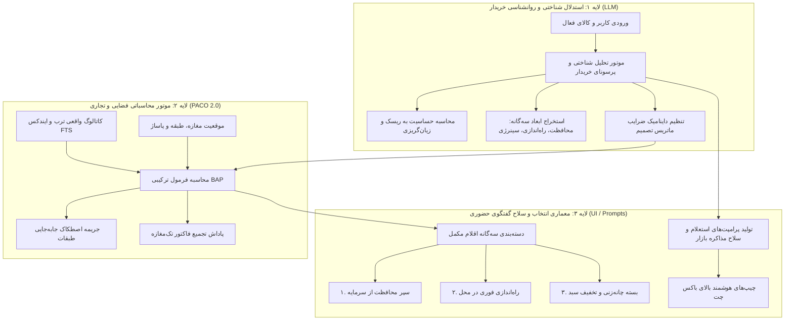

# معماری و فرمول‌بندی الگوریتم BAP-LLM
## Behavioral & Analytical Purchasing Engine with LLM Reasoning

این سند مشخصات فنی، معماری سیستم، فرمول‌های ریاضی و الگوهای تعاملی الگوریتم جدید **BAP-LLM** است که حاصل نشست مشترک تیم روانشناسی شناختی و تیم فروش و بازاریابی کَلَم می‌باشد.



---

## ۱. لایه اول: مدل‌سازی حالت شناختی و پرسونای خریدار (LLM Cognitive Profiler)

مدل زبانی (LLM) در اولین گام، کالا، فروشگاه و رفتار کاربر را بررسی کرده و ویژگی‌های زیر را تولید می‌کند:

### ۱.۱. ابعاد رفتاری خریدار (Behavioral Vectors)
1. **شاخص حساسیت به ریسک ($\rho_{risk} \in [0.1, 1.0]$):**  
   کالاهای گران‌قیمت یا الکترونیکی حساس (گوشی، لپ‌تاپ، دوربین) دارای $\rho_{risk} \ge 0.85$ هستند. این شاخص وزن گارانتی، پلمپ شرکتی و سلامت فیزیکی را در انتخاب فروشگاه و مکمل‌ها بالا می‌برد.
2. **شاخص حساسیت به اصطکاک فیزیکی ($\sigma_{friction} \in [0.1, 1.0]$):**  
   در خریدهای فوری یا پاساژهای پرتردد، هزینه حرکت بین طبقات برای خرید وسایل ارزان به شدت بالاست ($\sigma_{friction} \approx 0.90$).
3. **شاخص قابلیت چانه‌زنی سبدی ($\gamma_{bargain} \in [0.0, 1.0]$):**  
   پتانسیل اصناف برای تخفیف روی فاکتور تجمیعی (مثلاً لوازم جانبی موبایل $\gamma = 0.95$، دریل و مته $\gamma = 0.85$).

---

## ۲. لایه دوم: فرمول ریاضی PACO 2.0 (Grounded Spatial-Commercial Engine)

فرمول جدید PACO 2.0 به جای حاصل‌ضرب ساده، یک ساختار خطی-وزنی با توان‌های اصلاحی و پاداش تجمیعی سبد است:

$$S_{BAP} = \Big[ w_{dep} \cdot F_{dep} + w_{spatial} \cdot \Psi_{retail} + w_{econ} \cdot \Omega_{mental} + w_{trust} \cdot \Phi_{fair\_deal} \Big] \times \mu_{model\_fit} \times \Theta_{bundle\_bonus}$$

که در آن:
$$\sum w = w_{dep} + w_{spatial} + w_{econ} + w_{trust} = 1.0$$

ضرایب وزنی بر اساس خروجی لایه شناختی LLM به صورت پویا مقادیر زیر را می‌گیرند:
- برای کالاهای حساس به اصالت: $w_{trust} = 0.35, w_{spatial} = 0.30, w_{dep} = 0.20, w_{econ} = 0.15$
- برای ابزارآلات و ملحقات فوری: $w_{spatial} = 0.40, w_{dep} = 0.30, w_{trust} = 0.15, w_{econ} = 0.15$

### ۲.۱. تابع اصطکاک فیزیکی پاساژ با شیب افت تصاعدی ($\Psi_{retail}$)
برخلاف فرمول قدیمی که به مغازه طبقه دیگر ۰.۷۴ می‌داد، در PACO 2.0 افت پیاده‌روی به شکل زیر اصلاح شد:

$$\Psi_{retail} = \begin{cases} 
1.00 & \text{اگر در همان مغازه باشد (Same Shop)} \\
0.55 & \text{اگر در همان طبقه، مغازه دیگر باشد (Same Floor, Walk < 50m)} \\
0.30 - (0.05 \times |\Delta \text{floor}|) & \text{اگر در طبقه دیگر باشد (Vertical Elevator Friction)} \\
0.15 & \text{اگر در راسته یا پاساژ دیگر باشد}
\end{cases}$$

> **توجیه تجاری:** برای یک قلم ارزان (زیر ۳۰۰ هزار تومان)، افتادن در دام جابه‌جایی طبقه به معنای انصراف قطعی خریدار است.

### ۲.۲. تابع اصلاح‌شده حسابداری ذهنی ($\Omega_{mental}$)
فرمول قبلی قیمت‌های بالاتر از ۳۵٪ را تنبیه می‌کرد. در فرمول جدید، آستانه مجاز بر اساس نقش شناختی تعیین می‌شود:

$$\Omega_{mental} = \begin{cases}
1.00 & \text{if } \text{ratio} \le \text{Threshold}_{role} \\
\max\left(0.40, 1.00 - 1.2 \times (\text{ratio} - \text{Threshold}_{role})\right) & \text{if } \text{ratio} > \text{Threshold}_{role}
\end{cases}$$

که آستانه‌ها به شرح زیرند:
- **سپر محافظت از زیان (Protective / Insurance):** $\text{Threshold} = 0.30$ (خریدار تا ۳۰٪ ارزش کالا را برای محافظت از آن هزینه معقول می‌داند).
- **راه‌اندازی ضروری و ملحقات (Consumable / Starter):** $\text{Threshold} = 0.20$.
- **تکمیل اکوسیستم و سینرژی (Ecosystem / Synergy):** $\text{Threshold} = 0.60$ (مثل خرید هدفون همراه گوشی یا شارژر فست اصلی).

### ۲.۳. ضریب پاداش بسته تجمیعی فروشگاه ($\Theta_{bundle\_bonus}$)
$$\Theta_{bundle\_bonus} = \begin{cases}
1.40 & \text{اگر در همان مغازه باشد و حاشیه سود صنف اجازه چانه‌زنی فاکتوری بدهد} \\
1.00 & \text{در سایر موارد}
\end{cases}$$

---

## ۳. لایه سوم: معماری انتخاب سه‌گانه و سلاح مذاکره (Cognitive Trio & Bazaar Scripting)

### ۳.۱. دسته‌بندی سه‌گانه در رابط کاربری (The Cognitive Trio)
به جای نمایش یک لیست درهم از ۸ کالا، سیستم کالاها را حداکثر در **۳ باکس هدفمند** عرضه می‌کند:

1. **سپر محافظت از سرمایه (Loss Aversion Shield):**
   - *عنوان رابط کاربری:* «محافظت از سرمایه‌گذاری شما»
   - *کالاها:* گلس تمام‌صفحه سرامیکی، قاب ضربه‌گیر ارتش، محافظ لنز، کیف ضدضربه، فیوز برق.
   - *پیام شناختی:* «جلوگیری از آسیب دیدن و کاهش افت قیمت کالا هنگام فروش مجدد.»

2. **راه‌اندازی فوری در محل (Out-of-Box Readiness):**
   - *عنوان رابط کاربری:* «اقلام راه‌اندازی بدون معطلی»
   - *کالاها:* آداپتور ۲۵ وات (حذف شده از جعبه)، مته چهارشیار دریل، دانه قهوه، کابل رابط.
   - *پیام شناختی:* «این کالا بدون این قطعه در منزل یا کارگاه روشن نمی‌شود.»

3. **بسته تخفیف سبدی در همین مغازه (Same-Store Bundle Bargain):**
   - *عنوان رابط کاربری:* «پیشنهاد تجمیع فاکتور با تخفیف»
   - *پیام تجاری:* «این ۲ قلم در همین مغازه موجودند؛ می‌توانید روی جمع فاکتور ۱۰ تا ۱۵ درصد تخفیف نقدی بگیرید.»

---

## ۴. استخراج هوشمند «سلاح مذاکره بازار» (Bazaar Battle Prompts)

سوالات آماده بالای باکس چت دیگر یک سرچ منفعلانه نیستند؛ بلکه جملاتی برای غلبه بر ترفندهای مرسوم بازار و قدرت‌بخشی به خریدار هستند:

```json
{
  "in_store_prompts": [
    {
      "type": "anti_hidden_fee",
      "label": "سپر ضد هزینه پنهان",
      "text": "قیمت نهایی فاکتور بدون هزینه اجباری فعال‌سازی، نصب نرم‌افزار یا ریجستر چقدره؟"
    },
    {
      "type": "bundle_discount_lever",
      "label": "اهرم تخفیف تجمیعی",
      "text": "اگر قاب و گلس و شارژر رو هم از خودتون بردارم، روی کل فاکتور چقدر تخفیف پای پوز میدید؟"
    },
    {
      "type": "unboxing_warranty_probe",
      "label": "تست سلامت و پلمپ",
      "text": "پلمپ جعبه و گارانتی ۱۸ ماهه شرکتی جلوی خودم بررسی و استعلام سامانه همتا میشه؟"
    },
    {
      "type": "same_shop_compatibility",
      "label": "انطباق در محل",
      "text": "شارژر اصلی با ضمانت داغ نکردن و تطابق وات دقیق برای همین مدل از خودتون داری؟"
    }
  ]
}
```

---

## ۵. ماتریس پیاده‌سازی و یکپارچه‌سازی در کدبیس کَلَم

| فایل کدبیس | وضعیت فعلی | تغییر بر اساس معماری BAP-LLM |
| :--- | :--- | :--- |
| `backend/algorithms/paco.py` | فرمول ضربی ساده با جریمه کم برای تغییر طبقه | پیاده‌سازی فرمول وزن‌دار $S_{BAP}$ با پاداش تک‌مغازه $\Theta = 1.40$ و افت شدید تغییر طبقه ($\Psi = 0.30$) |
| `backend/algorithms/ai_product_intelligence.py` | دریافت ابعاد بدون دسته‌بندی شناختی | تغییر سیستم پرامپت به دسته‌بندی سه‌گانه رفتاری (سپر، راه‌اندازی، تجمیع تخفیف) + تولید پرامپت‌های چانه‌زنی |
| `backend/algorithms/prompt_generator.py` | گزینه‌های استاتیک هاردکد با رگکس | اولویت‌دهی به پرامپت‌های سلاح مذاکره، استعلام پلمپ و تخفیف سبدی تولیدشده توسط هوش مصنوعی |
| `backend/algorithms/recommend.py` | تمرکز ۴۵٪ بر ارزان‌ترین قیمت خام | افزودن ضریب سلامت و شفافیت معامله به امتیاز فروشگاه برای محافظت از خریدار در برابر فریب قیمتی |
| `frontend / UI` | لیست ساده کاروسل کالا | تب‌بندی سه‌گانه مکمل‌ها (سپر محافظتی، راه‌اندازی، بسته تخفیفی) |
