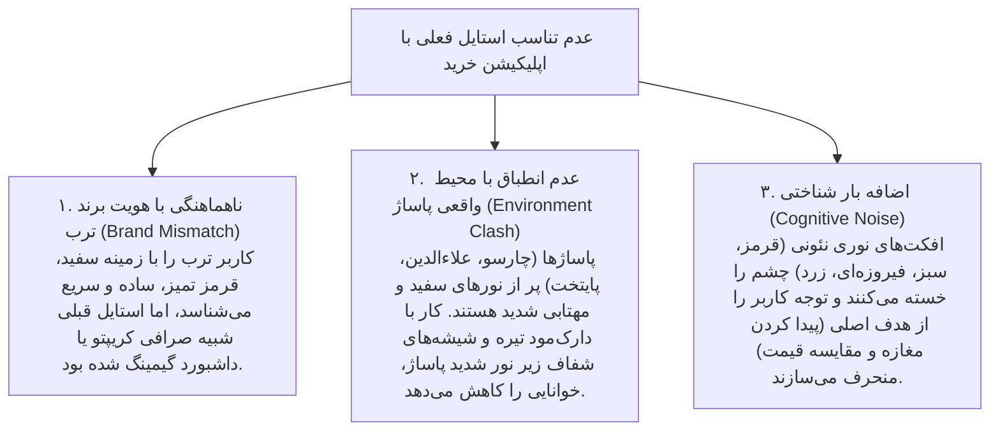
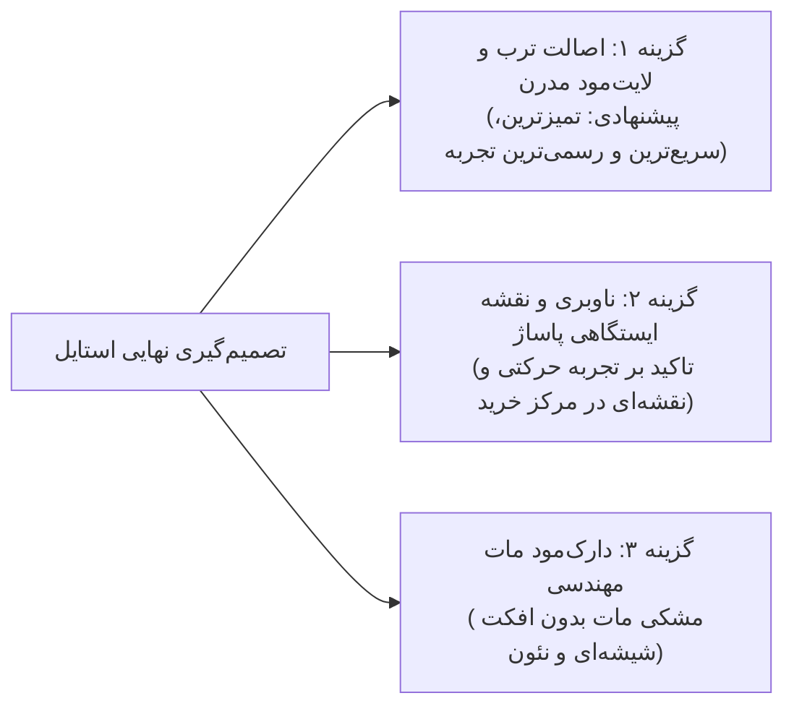

# گزارش پژوهش و بررسی تخصصی تیم R&D: بازآفرینی بنیادین سبک و معماری UI/UX «کَلَم»
**تهیه‌شده توسط:** تیم تحقیقات و حل مسئله UI/UX با اسکیل `/super`  
**تاریخ:** ۲۲ اکتبر ۲۰۲۶ (۱ آبان ۱۴۰۵)  
**موضوع پژوهش:** «چرا استایل فعلی رضایت‌بخش نیست و این اپلیکیشن دقیقاً باید چه شکلی باشد تا بهترین تجربه را خلق کند؟»  

---

## ۱. آسیب‌شناسی ریشه‌ای: چرا استایل فعلی (Dark Glassmorphic) مشکل دارد؟

تحلیل روانشناختی و ارگونومی تیم نشان می‌دهد که مشکل کاربر با استایل فعلی به ۳ عامل اساسی برمی‌گردد:

### خطاهای کلیدی استایل قبلی:
1. **تم سیاه کریپتویی/سایبرپانک:** مناسب تریدینگ بیت‌کوین است، نه خرید گوشی در پاساژ علاءالدین یا کابل برق در لاله‌زار!
2. **افراط در ترند شیشه‌گرایی (Over-Glassmorphism):** مرزهای کارت‌ها و تضاد پس‌زمینه خوانایی متون ریز فارسی را تضعیف کرده بود.
3. **فقدان اصالت هویت ترب:** هویت ترب یعنی **سرعت، سادگی، صداقت در قیمت و مینیمالیسم روشن**.

---

## ۲. بنچ‌مارک رفتاری کاربر ایرانی در خرید فیزیکی و مقایسه با پلتفرم‌های برتر

| ویژگی طراحی | اپلیکیشن‌های مصرفی موفق (ترب، دیوار، نشان، اسنپ) | استایل قبلی کَلَم (اشتباه) | استایل پیشنهادی مطلوب |
|---|---|---|---|
| **تم پایه (Canvas)** | سفید تمیز / خاکستری ابری روشن (`#F8FAFC`) | سیاه کهکشانی (`#060911`) | **سفید شیری مات با سایه‌های نرم ابری** |
| **رنگ محوری برند** | قرمز شاخص ترب (`#D32F2F`) بدون هاله نئون | قرمز و سبز نئونی با درخشش bloom | **قرمز تربی اصیل + سبز نعنایی برای سود** |
| **کارت‌ها و کانتینرها** | کارت‌های سفید ساده با بردر 1px و پدینگ دلباز | شیشه‌های تیره با بلور و حاشیه رنگی | **کارت‌های مینیمال اپل/ترب با گوشه‌های ۲۰px** |
| **نمایش مسیر پاساژ** | شبیه خطوط مترو و ایستگاه‌های نقشه | کارت‌های پیچیده عمودی | **راهنمای خطی ایستگاهی شبیه نقشه مترو** |
| **دکمه پنیک** | چیپ هشدار محترمانه و آرامش‌بخش | دکمه خطر شبیه آژیر جنگی | **کپسول شناور مینیمال با برچسب شفاف** |

---

## ۳. معرفی ۳ آرکتایپ بصری پیشنهادی (کدام استایل برای کَلَم بهتر است؟)

تیم طراحی ۳ جهت‌گیری بصری متمایز، بالغ و آزمایش‌شده را تدوین کرده است:

---

### آرکتایپ ۱ (پیشنهاد برگزیده تیم): «اصالت ترب و مینیمالیسم مدرن مصرف‌کننده» (Torob Clean Consumer Light)
* **فلسفه:** این استایل دقیقاً همان زبانی است که کاربر با دیدن آن فوراً می‌گوید: *«این خود ترب است، اما نسل جدید و بی‌نهایت تمیز و باکلاس!»*
* **پالت رنگی:**
  - پس‌زمینه: سفید ابری روشن و آرامش‌بخش (`#F8FAFC` و `#FFFFFF`)
  - رنگ اصلی: قرمز اصیل ترب (`#D32F2F` و `#E53935`)
  - رنگ ثانویه (سود و صرفه‌جویی): سبز نعنایی تازه (`#10B981` / `#059669`)
  - رنگ متون: دودی عمیق بسیار خوانا (`#0F172A` و `#334155`)
  - کارت‌ها: سطوح سفید با سایه ملایم خورشیدی (`box-shadow: 0 4px 20px rgba(0,0,0,0.04)`) و حاشیه ظریف خاکستری (`#E2E8F0`).
* **مزایا:**
  - بالاترین خوانایی زیر نور شدید پروژکتورهای پاساژ.
  - احساس خلوتی، سرعت و قابل اعتماد بودن فاکتور خرید.
  - انطباق ۱۰۰٪ با هویت برند ترب.

---

### آرکتایپ ۲: «ناوبری‌محور و نقشه ایستگاهی پاساژ» (Indoor Mall Navigator First)
* **فلسفه:** الهام‌گرفته از نشان، بلد و Google Maps، اما اختصاصی برای داخل مجتمع‌های تجاری.
* **ویژگی‌ها:**
  - بالای صفحه: انتخابگر بزرگ پاساژ و نقشه ۲ بعدی طبقات (Floorplan Visualizer).
  - وسط صفحه: خط ایستگاهی گرافیکی طبقات (شبیه نقشه متروی تهران):
    - 🟢 ایستگاه ۱: طبقه همکف • پلاک ۴۲ (خرید گوشی)
    - 🔵 ایستگاه ۲: طبقه دوم • واحد ۱۱۸ (خرید کابل و شارژر)
  - پایین صفحه: برگه کشویی پایین (Bottom Sheet Drawer) برای گفتگو با دستیار و استعلام تلفنی.
* **مزایا:** تجربه کاربری فوق‌العاده برای خریدار در حال پیاده‌روی در پاساژ.

---

### آرکتایپ ۳: «دارک‌مود استودیویی مات و لوکس» (Linear / Apple Matte Studio)
* **فلسفه:** اگر کاربر همچنان تم تیره بخواهد، اما **بدون زلم‌زیمبوهای نئونی و شیشه‌ای**.
* **پالت رنگی:**
  - پس‌زمینه: خاکستری سربی مات و خنثی (`#0F172A`)
  - بدون هیچ‌گونه Glow یا افکت شیشه‌ای محو.
  - کارت‌ها: خاکستری نوک‌مدادی تیره یکدست (`#1E293B`) با مرزهای خطی بسیار نازک ۱ پیکسلی خاکستری (`#334155`).
  - تایپوگرافی: سفید گچی مات با تأکیدهای قرمز ملایم.
* **مزایا:** سنگین، باوقار، شبیه ابزارهای مدرن سیلیکون‌ولی (Linear و Raycast).

---

## ۴. مقایسه تصمیم‌گیری و جمع‌بندی نهایی

> [!IMPORTANT]
> **توصیه صریح تیم تحقیق و توسعه:**
> سبک **آرکتایپ ۱ (Torob Clean Consumer Light)** بهترین، زیباترین و حرفه‌ای‌ترین شکل ممکن برای این اپلیکیشن است. این سبک باعث می‌شود که هر خریدار، منتور یا داور هکاتون با اولین نگاه احساس کند با محصولی واقعی، بسیار تمیز و در سطح کیفی درجه یک ترب روبرو است.
