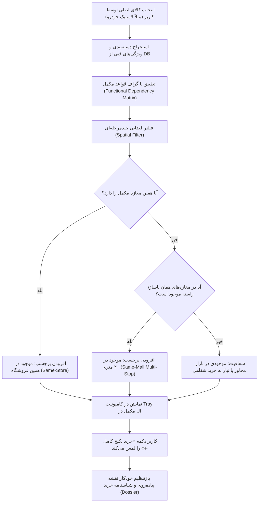

# موتور پیشنهاد کالاهای مکمل و سبد خرید متمرکز در پاساژ (Smart In-Person Complementary Engine)

## ۱. فلسفه و ارزش استراتژیک در خرید فیزیکی (The "Zero Second-Trip" Philosophy)

در تجارت الکترونیک مرسوم (مانند دیجی‌کالا یا آمازون)، پیشنهاد کالای مکمل (Cross-sell / Recommendation) صرفاً ترفندی تجاری برای افزایش میانگین ارزش سبد خرید (AOV) است؛ اگر کاربر کالای مکمل را نخرد، بعداً می‌تواند با یک کلیک سفارش دهد و پیک آن را بیاورد.

اما در **خرید حضوری در کلان‌شهری مثل تهران**، قضیه مرگ و زندگی است:
- خریدار ۲ ساعت در ترافیک بزرگراه همت و طرح ترافیک رانندگی کرده، ۲۰۰ هزار تومان هزینه پارکینگ و سوخت داده و پای پیاده پاساژهای شلوغ امیرکبیر، چراغ‌برق یا علاءالدین را زیر پا گذاشته است.
- اگر او **لاستیک خودرو** بخرد اما **والو (سوزن و والف چرخ)** را یادش برود، یا آپاراتی به او بگوید «والف پوسیده و باد خالی می‌کنه»، کل خریدش بی‌فایده می‌شود و باید روز کاری بعد دوباره ساعت‌ها در ترافیک و بازار بچرخد!
- همین مسئله برای خرید **دوربین مداربسته بدون آداپتور و فیش BNC**، خرید **پمپ آب بدون ست‌کنترل و نوار تفلون**، و خرید **کابل برق بدون فیوز مینیاتوری** تکرار می‌شود.

> **هدف بنیادین موتور مکمل فیزیکی ترب:**  
> **«یک‌بار ورود به بازار = ۱۰۰٪ تکمیل ملزومات راه‌اندازی (One-Stop Physical Shopping & Zero Second-Trip Guarantee)»**

---

## ۲. طبقه‌بندی روابط مکمل: تفکیک ملزومات حیاتی از لوازم جانبی تزئینی

برای اینکه سیستم رفتار یک **فروشنده باتجربه بازار (Veteran Shopkeeper Intuition)** را شبیه‌سازی کند، کالاهای پیشنهادی در دو لایه طبقه‌بندی می‌شوند:

### الف) ملزومات حیاتی نصب و راه‌اندازی (Mandatory Operational Essentials)
کالاهایی که بدون آنها، استفاده و راه‌اندازی کالای اصلی **غیرممکن یا پرخطر** است:
- **لاستیک تایر خودرو:** ➔ ۱. والو تایر (Valve Stem برنجی/استیل) ۲. سرب بالانس چرخ ۳. مهره و پیچ چرخ ضدسرقت
- **دوربین مداربسته:** ➔ ۱. فیش و کانکتور BNC پیچی/پرسی ۲. آداپتور تغذیه ۱۲ ولت ۳. کابل کواکسیال ترکیبی RG59 ۴. هارد بنفش نظارتی
- **سیم و کابل برق:** ➔ ۱. کلید مینیاتوری متناسب با آمپراژ ۲. نوار چسب نسوز برق ۳. سرسیم و ترمینال شاخه‌ای
- **پمپ آب خانگی:** ➔ ۱. کلید اتوماتیک / ست‌کنترل دیجیتال ۲. منبع تحت فشار درجه‌دار ۳. پنج‌راهی برنجی ۴. نوار تفلون صنعتی

### ب) محافظت و افزایش طول عمر (Protection & Maintenance)
کالاهایی که خرید همزمان آنها ارزش اقتصادی و محافظتی بالایی دارد:
- **گوشی موبایل / تبلت:** ➔ گلس سرامیکی/آنتی‌استاتیک + قاب ضدضربه + کابل شارژ تقویت‌شده
- **لنز دوربین عکاسی:** ➔ فیلتر UV لنز + هود آفتاب‌گیر + دستمال میکروفایبر اپتیک
- **دریل و ابزار برقی:** ➔ مته‌های آهن و بتن سایزهای استاندارد + عینک محافظ کار

---

## ۳. ماتریس نمونه‌های واقعی استخراج‌شده از دیتاست ترب (Actual Dataset Graph)

```
┌──────────────────────────────────────┬───────────────────────────────┬────────────────────────────────────────────────────────┐
│ راسته بازار / بورس تخصصی تهران       │ کالای اصلی انتخابی خریدار     │ اقلام مکمل موجود در کاتالوگ دیتابیس ترب               │
├──────────────────────────────────────┼───────────────────────────────┼────────────────────────────────────────────────────────┤
│ 🚗 خیابان امیرکبیر / چراغ‌برق        │ لاستیک سواری رادیال (بارز/کویر)│ ۱. والو لاستیک و سوزن والف  ۲. قفل رینگ  ۳. باد نیتروژن │
│ ⚡ راسته لاله‌زار جنوبی و شمالی       │ سیم و کابل برق افشان          │ ۱. کلید و فیوز مینیاتوری  ۲. داکت و ترانکینگ  ۳. کلید پریز │
│ 📹 بورس امنیت (علاءالدین/امجد)       │ دوربین مداربسته دید در شب     │ ۱. فیش BNC  ۲. آداپتور ۱۲V صنعتی  ۳. هارد دیسک نظارتی │
│ 🚰 خیابان خیام و راسته سعدی          │ پمپ آب خانگی و صنعتی          │ ۱. ست‌کنترل اتوماتیک  ۲. منبع انبساط  ۳. پنج‌راهی برنجی│
│ 📱 پاساژ چارسو و بازار موبایل        │ تاچ و ال‌سی‌دی تعویضی موبایل   │ ۱. چسب ضدآب T7000  ۲. محافظ گلس  ۳. باتری تقویت‌شده   │
│ 🔧 راسته حسن‌آباد (میدان قزوین)       │ دریل برقی و پیچ‌گوشتی شارژی    │ ۱. ست سرپیچ‌گوشتی و مته  ۲. عینک ایمنی  ۳. رابط فنری   │
└──────────────────────────────────────┴───────────────────────────────┴────────────────────────────────────────────────────────┘
```

---

## ۴. معماری فنی ۴ مرحله‌ای موتور پیشنهاد مکمل (Architectural Pipeline)



### ۱. جستجوی داخلی همان فروشگاه (Same-Store Query):
ابتدا کوئری زده می‌شود:
```sql
SELECT p.persian_title, o.price_toman, o.offer_id 
FROM offers o
JOIN products p ON o.product_id = p.product_id
WHERE o.shop_id = :selected_shop_id 
  AND p.category_name IN (:complementary_categories)
ORDER BY o.price_toman ASC
LIMIT 3;
```
اگر مغازه این مکمل را داشته باشد، بالاترین امتیاز اولویت به آن داده می‌شود چون خرید بدون حتی یک قدم جابه‌جایی انجام می‌گیرد.

### ۲. جستجوی شعاعی در همان پاساژ/راسته (Same-Mall Fallback):
اگر فروشگاه اصلی والو چرخ را نداشت:
```sql
SELECT s.name, s.address, p.persian_title, o.price_toman 
FROM offers o
JOIN shops s ON o.shop_id = s.shop_id
JOIN products p ON o.product_id = p.product_id
WHERE s.location_label = :current_mall_label
  AND p.category_name IN (:complementary_categories)
ORDER BY o.price_toman ASC
LIMIT 2;
```

---

## ۵. طراحی رابط کاربری (UI/UX Component Specification)

### الف) کامپوننت کشوی پکیج کامل (Complementary Bundle Tray):
در زیر کارت هر محصول انتخاب‌شده در صفحه جستجو یا چت، باکسی متمایز با زمینه ملایم و رنگ برند ترب قرار می‌گیرد:

```
┌────────────────────────────────────────────────────────────────────────┐
│ 🛍️ پکیج کامل راه‌اندازی (پیشنهاد هوشمند برای عدم مراجعه مجدد به بازار) │
├────────────────────────────────────────────────────────────────────────┤
│ ☑️ تایر رادیال بارز ۱۶۵/۶۵R۱۳ (کالای اصلی)         ۲,۴۵۰,۰۰۰ تومان    │
│    فروشگاه رینگ و لاستیک البرز (خیابان امیرکبیر، پلاک ۱۱۸)              │
│                                                                        │
│ ➕ ۴ عدد والو چرخ تایر برنجی ضدخوردگی (مکمل حیاتی)     ۱۲۰,۰۰۰ تومان    │
│    [سبز: موجود در همین فروشگاه ✅]                                      │
│                                                                        │
│ ➕ ۴ عدد مهره چرخ ضدسرقت رینگ (محافظت و ایمنی)         ۲۸۰,۰۰۰ تومان    │
│    [آبی: فروشگاه سهند، ۵ مغازه بالاتر در همین راسته 📍]                │
├────────────────────────────────────────────────────────────────────────┤
│ جمع کل پکیج راه‌اندازی: ۲,۸۵۰,۰۰۰ تومان                                 │
│ [ دکمه: اضافه کردن پکیج کامل به مسیر خرید من 🎯 ]                       │
└────────────────────────────────────────────────────────────────────────┘
```

### ب) انتقال خودکار به شناسنامه خرید (Dossier Integration):
وقتی کاربر پکیج را تایید کرد، شناسنامه نهایی خرید به این صورت سازماندهی می‌شود:
- **ایستگاه اول (مغازه اصلی):** تایرها + والوهای چرخ (یک‌جا تحویل گرفته شود).
- **ایستگاه دوم (۵ مغازه بالاتر):** قفل رینگ‌های ضدسرقت.
- **توصیه فنی ایجنت در شناسنامه:**  
  *«هنگام نصب لاستیک در آپاراتی، تعویض والو کهنه با والوهای جدید خریداری‌شده الزامی است تا مانع خالی شدن تدریجی باد در سرعت بالا گردد.»*

---

## ۶. تضمین ضد توهم و بی‌طرفی پلتفرم (Zero-Hallucination & Neutrality)

۱. **عدم توصیه برندهای ناموجود:** هوش مصنوعی هرگز محصولی که در دیتاست یا راسته فیزیکی وجود خارجی ندارد به عنوان مکمل قطعی قیمت‌گذاری نمی‌کند.
۲. **بی‌طرفی در انتخاب مغازه دوم:** اگر چند مغازه در همان پاساژ مکمل را داشته باشند، سیستم بر اساس فاصله و شفافیت قیمت گزینه‌ها را پیشنهاد می‌دهد نه زدوبند تبلیغاتی.
۳. **شفافیت وضعیت موجودی:** در صورتی که کالای مکملی مثل والو چرخ در دیتابیس قیمت قطعی نداشته باشد، با برچسب زرد هشدار داده می‌شود: *«استعلام قیمت در محل؛ توصیه می‌شود همزمان از مغازه تهیه فرمایید.»*

