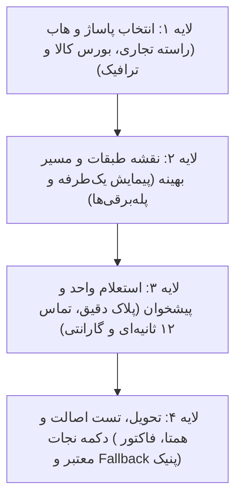

# 🥬 کَلَم (Kalam) | دستیار فوق‌هوشمند خرید حضوری ترب

<div align="center">
  
  <h3>سامانه بهینه‌سازی سبد خرید چندقلمی، مسیریابی سه‌بعدی پاساژها و نجات از مغازه بسته</h3>
  <p>طراحی شده بر بستر داده‌های واقعی ۲۲۵,۹۰۳ محصول و ۶,۴۷۶ فروشگاه فیزیکی ترب در قطب‌های تجاری تهران</p>

  <p>
    <a href="#-الگوریتم‌های-۷گانه-کلم"></a>
    <a href="#-معماری-طراحی-precision-matte-studio"></a>
    <a href="#-راه‌اندازی-سریع-quick-start"></a>
    <a href="public/WHITEPAPER_KALAM.pdf"></a>
  </p>
</div>

---

## 📖 معرفی پروژه و چرایی نام «کَلَم»

خرید حضوری در پاساژها و مجتمع‌های تجاری بزرگ (نظیر بازار چارسو، علاءالدین، پایتخت، لاله‌زار، شوش و بازار بزرگ) تجربه‌ای طاقت‌فرسا همراه با خستگی ناشی از پیمایش طبقات متوالی، تفاوت قیمت‌های سردرگم‌کننده و ریسک بسته بودن مغازه یا اتمام موجودی است.

نام **«کَلَم»** از استعاره **پوست‌کندن گام‌به‌گام لایه‌های خرید در بازار** الهام گرفته شده است:



---

## 🔬 الگوریتم‌های ۷گانه کَلَم

کَلَم مجهز به ۷ الگوریتم اختصاصی برای پردازش فضای فیزیکی خرده‌فروشی است:

| # | نام الگوریتم | کد اختصاری | عملکرد کلیدی |
| :--- | :--- | :--- | :--- |
| **۱** | **In-Person Cart Routing Problem** | `IP-CRP` | مسیریاب سبد خرید چندقلمی در فضای سه‌بعدی پاساژها با قید صعود یک‌طرفه و حمل کالای سنگین در ایستگاه آخر. |
| **۲** | **Spatial & Asymmetric Complementarity** | `PACO` | پیشنهاد اقلام مکمل در همان طبقه با فیلتر خودکار برندهای رقیب و جانشین هم‌عرض. |
| **۳** | **Indoor Mall Wayfinding Parser** | `IMWP` | پارسر هوشمند آدرس‌های متنی سنتی بازار، استخراج طبقات منفی و تولید راهنمای کلامی سه‌مرحله‌ای. |
| **۴** | **BNPL & In-Person POS Matcher** | `CrediPay` | اعتبارسنجی پذیرنده‌های فیزیکی اسنپ‌پی، ترب‌پی، تارا و دیجی‌پی بر اساس پایانه پوز متصل. |
| **۵** | **Interactive Need Decoupling Protocol** | `INDP` | غربالگری نیازهای مبهم خریدار در کمتر از ۳ ثانیه با درخت تشخیصی دوراهی. |
| **۶** | **Stock Certainty & 12s Inquiry Dossier** | `SVDP` | تنزیل زمانی قیمت‌های ثبت‌شده و تولید اسکریپت صوتی ۱۲ ثانیه‌ای جهت برقراری تماس قبل از حرکت. |
| **۷** | **Triple-Fallback Resilient Architecture** | `TFRA` | دکمه نجات پنیک (Panic Button): یافتن کالای جایگزین در همان طبقه (زیر ۲۰ متر)، همان پاساژ یا راسته مجاور هنگام برخورد با مغازه بسته. |

---

## 🎨 معماری طراحی: Precision Matte Studio

رابط کاربری کَلَم پس از تحقیقات عمیق R&D بر مبنای متدولوژی **Linear / Apple Matte Studio** بازطراحی شده است تا حداکثر کارایی و خوانایی را در محیط‌های پرنور پاساژها فراهم کند:

- **رنگ‌های مات و مهندسی:** پس‌زمینه گرافیتی زغالی عمیق (`#080C14` و `#0d1424`) با خطوط مرزی دقیق ۱ پیکسلی (`#1e2a44`).
- **هویت سبز کلمی:** رنگ سبز طبیعی (`#22C55E` و `#16A34A`) برای تأیید اعتبار و شاخص‌های زنده.
- **تایپوگرافی استاندارد فارسی:** استفاده از فونت وزیرمتن (Vazirmatn) با اعداد صددرصد فارسی.
- **حذف گلس‌مورفیسم و نئون:** عدم انعکاس نور زیر تابش لامپ‌های بازار و مصرف بهینه باتری گوشی هوشمند.

---

## 🚀 راه‌اندازی سریع (Quick Start)

### پیش‌نیازها
- پایتون نسخه 3.9 به بالا

### ۱. کلون مخزن
```bash
git clone https://github.com/odimmraptor-collab/kalam-torob.git
cd kalam-torob
```

### ۲. نصب وابستگی‌ها
```bash
pip install -r requirements.txt
```

### ۳. ساخت پایگاه داده (اختیاری در صورت داشتن دیتاست)
اگر فایل‌های CSV دیتاست ترب در پوشه `dataset/` قرار دارد:
```bash
python scripts/build_db.py
```
*این اسکریپت جدول‌های نرمال‌شده `shops`, `products`, `offers` و جدول FTS5 جستجوی تمام‌متن فارسی را می‌سازد.*

### ۴. اجرای وب‌سرور
```bash
python -m uvicorn backend.main:app --host 127.0.0.1 --port 8000 --reload
```

سپس مرورگر خود را باز کرده و به آدرس زیر بروید:
👉 **`http://127.0.0.1:8000/`**

---

## 📂 ساختار فایل‌های پروژه

```text
kalam-torob/
├── backend/
│   ├── algorithms/          # پیاده‌سازی الگوریتم‌های ۷گانه
│   │   ├── ip_crp.py        # مسیریاب سبد خرید چندقلمی
│   │   ├── paco.py          # موتور مکمل فضایی و نامتقارن
│   │   ├── imwp.py          # پارسر آدرس‌های طبقات پاساژ
│   │   ├── credipay.py      # ماژول خریدهای اقساطی BNPL
│   │   ├── indp.py          # درخت غربالگری نیاز مبهم
│   │   ├── svdp.py          # اسکریپت استعلام ۱۲ ثانیه‌ای
│   │   └── tfra.py          # دکمه نجات پنیک مغازه بسته
│   ├── assistant.py         # مغز کوپایلوت و چت‌بات خریدار
│   └── main.py              # اِندپوینت‌های FastAPI و سرو فایل‌های استاتیک
├── public/
│   ├── app.css              # استایل‌شیت تم مات استودیویی کلم
│   ├── app.js               # کنترلر تعاملی فرانت‌اند
│   ├── index.html           # سند تک‌صفحه‌ای با ویجت ۴ لایه کلم
│   ├── logo.jpg             # لوگوی اختصاصی کلم ترب
│   ├── WHITEPAPER_KALAM.pdf # وایت‌پیپر رسمی پروژه
│   └── whitepaper_render.html
├── scripts/
│   ├── build_db.py          # اسکریپت بارگذاری سریع SQLite با FTS5
│   └── generate_pdf.py      # رندر نسخه چاپی PDF وایت‌پیپر
├── WHITEPAPER.md            # متن کامل وایت‌پیپر و اثبات‌های ریاضی
├── requirements.txt         # وابستگی‌های پایتون
└── README.md
```

---

## 📑 مستندات تکمیلی

- [وایت‌پیپر کامل پروژه (Markdown)](WHITEPAPER.md)
- [دانلود نسخه رسمی PDF وایت‌پیپر](public/WHITEPAPER_KALAM.pdf)

---

## ⚖️ لایسنس
توسعه یافته برای اکوسیستم خرید حضوری و هکاتون هوش مصنوعی ترب. تحت مجوز MIT.
